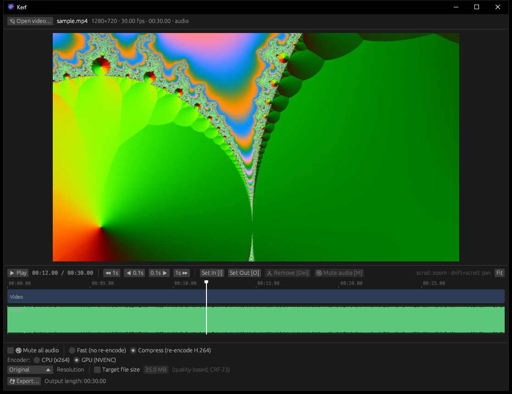

# Kerf


*kerf* (n.): the slit a blade leaves when it cuts.

A small, fast video editor for Windows, written in Rust. Cut parts out of a video, mute
all or part of its audio, and compress it, with optional downscaling and a target file size.



## Why I made it

I wanted a quick way to tidy up game clips before sharing them: cut out the boring or
unnecessary parts, and mute the moments with slurs or anything else that shouldn't be
heard, without opening a full video editor. Kerf is built for exactly that: open the
clip, mark a range, remove or mute it, export. Fast mode does it in seconds without
re-encoding, and Compress can squeeze the result under an upload size limit.

## Download

Get **`Kerf-<version>-windows-x64.zip`** from the [Releases page](https://github.com/TheSnapped/Kerf/releases/latest),
unzip it anywhere and run `kerf.exe`. Nothing is installed and no admin rights are needed.
Requires Windows 10/11 (64-bit).

Kerf uses ffmpeg, which is not included. Install it once:

```
winget install Gyan.FFmpeg
```

or put `ffmpeg.exe` and `ffprobe.exe` from https://www.gyan.dev/ffmpeg/builds/ next to `kerf.exe`.
An NVIDIA GPU (GTX 900 series or newer) enables the much faster NVENC encoder.

## Usage
- Open a video with the button, by dropping it on the window or on `kerf.exe`, or from the
  command line: `kerf.exe video.mp4 [--at <seconds>]`. The [Glance](https://github.com/TheSnapped/Glance)
  player uses `--at` for its "Open in Kerf" button.
- **Space** plays and pauses. Playback has sound and follows your edits: it skips removed parts and is silent where audio is muted.
- Click or drag the timeline to seek.
- **Mouse wheel** over the timeline zooms. **Shift+wheel** pans. **Fit** shows the whole video again.
- **I** sets the in point and **O** sets the out point.
  - **Del** removes that range from both video and audio. It shows red.
  - **M** silences just the audio in that range and keeps the video. It shows grey in the waveform with an amber outline.
  - Restore any range with its ✖.
- **←/→** step 0.1 s, **Shift+←/→** step 1 s, **Esc** clears the selection.

### Export
- **Mute all audio**: drops the audio track.
- **Fast (no re-encode)**: the video is copied without re-encoding, and cuts snap to keyframes. The audio is re-encoded only if parts of it are muted.
- **Compress**: H.264 re-encode. Only the kept segments are decoded, because each one is opened with its own seek. The encoder can be **CPU (x264)**, which gives the smallest files, or **GPU (NVENC)**. NVENC is detected automatically and is 3–7× faster, but files are larger at the same quality. You can downscale to 1080p/720p/480p. You can also set a target file size, which uses a two-pass encode at a bitrate calculated from that size. Without a target size it encodes at CRF 23.

## Building

Needs Rust (MSVC toolchain), and ffmpeg on PATH for running and testing.

```
.\build.ps1          # builds dist\kerf.exe (4 MB)
.\build.ps1 -Clean   # same, then deletes the build cache
.\package.ps1        # builds, then zips ..\releases\Kerf-<version>-windows-x64.zip
cargo run --release -- [video.mp4]
```

The UI is [egui](https://github.com/emilk/egui). Kerf runs `ffmpeg`/`ffprobe` for decoding
and encoding, and plays audio through `cpal`. `RELEASE-README.txt` becomes the README inside
the release zip. The icon is generated by `python assets/make_icon.py`.

The `target/` folder is cargo's build cache, about 0.5 GB per profile. `cargo clean` can delete it at any time.

### Tests
`cargo test` (needs ffmpeg) runs every export mode, the audio mute ranges, the waveform, and real-time playback on generated clips.

`cargo test --release bench -- --ignored --nocapture` times each export mode on a 90 s 1080p clip with grain.

## Made with AI

Kerf was built with the help of AI: the code was written together with Claude (Anthropic)
in Claude Code, directed, tested and reviewed by me.

## License

Kerf is licensed under the [GNU General Public License v3.0 or later](LICENSE).
